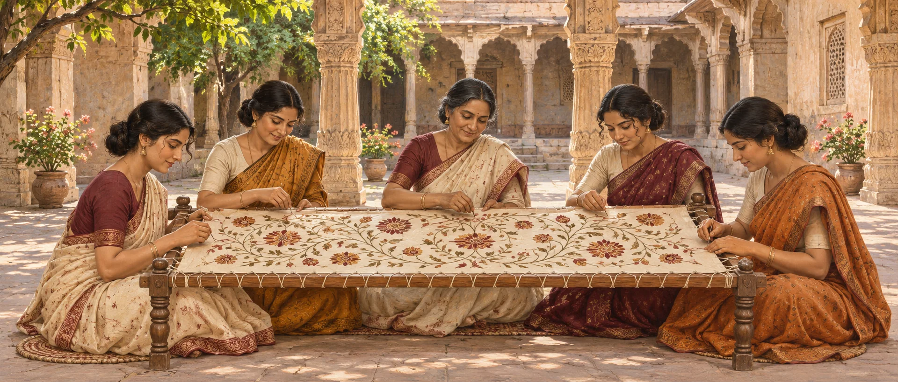
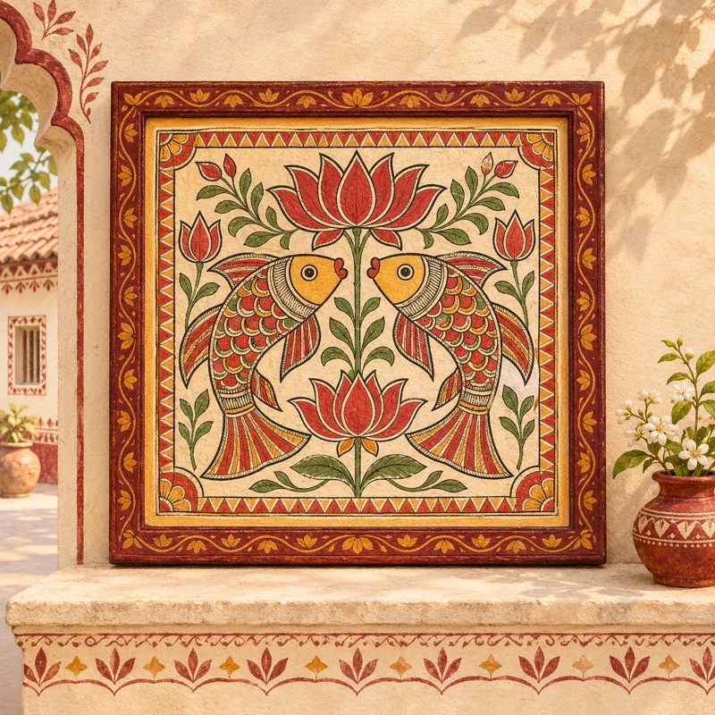
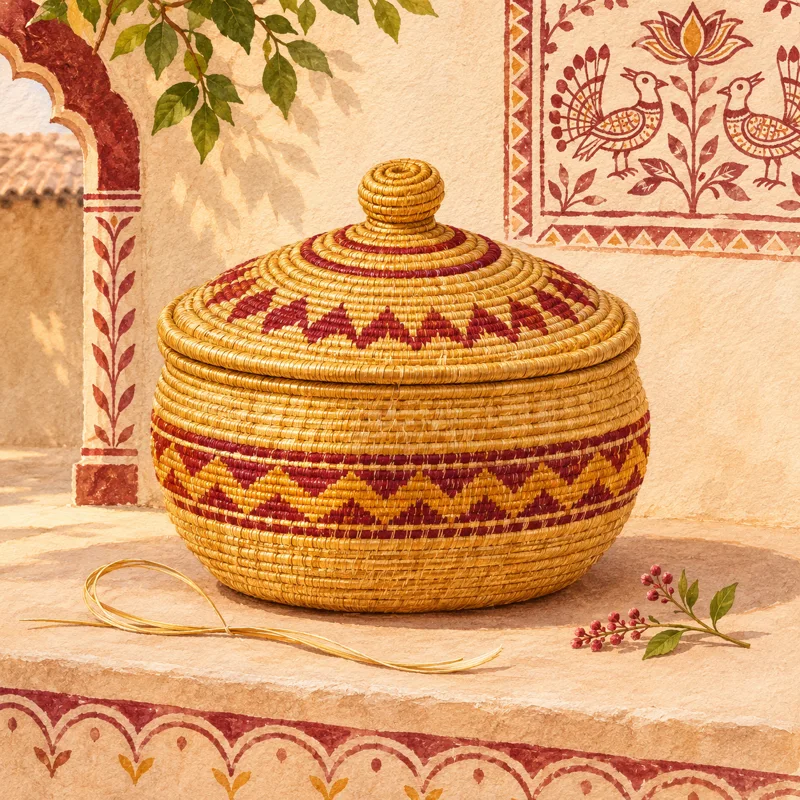
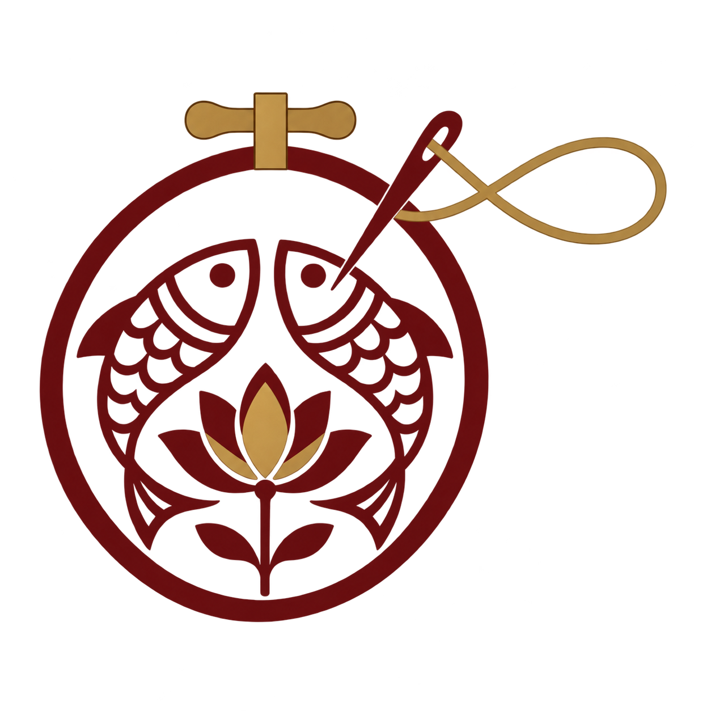

<div align="center">
  <picture>
    <source media="(prefers-color-scheme: dark)" srcset="public/brand/kalakriti-logo-reverse.webp">
    
  </picture>

  <h1>Living threads. Timeless traditions.</h1>
  <p><strong>मिथिलाक माटि</strong><br>The soil of Mithila. The stories of India.</p>
  <p>An Indian heritage marketplace in the making — beginning with Bihar,<br>and following the people, materials and traditions behind the craft.</p>

  <p><a href="#the-experience">The experience</a> · <a href="#run-locally">Run locally</a> · <a href="#the-design-language">Design language</a> · <a href="docs/README.md">Documentation</a></p>

  
  <p><sub>Editorial illustration · Rooted in a place. Made with meaning.</sub></p>
</div>

---

## The experience

Kalakriti brings regional craft stories into an illustrated, responsive discovery experience. This repository contains one **Next.js 14 application** with statically generated public pages.

| Chapter | What is implemented |
| --- | --- |
| **The heritage homepage** | A complete embroidery panorama, six regional stories in an automatic carousel, eight textile traditions, process stories and an artistic Mithila footer. |
| **Bihar, painted by hand** | A district-led Bihar page with a painted backdrop, nine craft collections, dedicated collection pages and four separate journal articles. Navigation works through ordinary links. |
| **A journey across India** | A separate `/explore` atlas with lazy-loaded Three.js relief, D3 map mode, state selection, regional hover themes and an optional cultural showcase. |
| **Regional craft introductions** | All 36 existing regional routes have introductions and craft content. Bihar has the detailed journal; the other 35 pages have selected craft descriptions and regional visual themes. |
| **Shared discovery** | Responsive navigation, regional links, local craft search, library icons and an illustrated brand identity. |

> **Current stage: heritage discovery and catalogue preview.** Product prices and experience ideas are illustrative previews. Shopping, bookings, subscriptions, accounts and payments are not live. There is no backend or database integration in this repository.

The atlas follows the existing geographic dataset and its legacy region keys. Its 36 routes are not a newly revised administrative map; see [regional content scope](docs/audit/STATE_CRAFT_CONTENT.md).

<table>
  <tr>
    <td width="50%"></td>
    <td width="50%"></td>
  </tr>
  <tr>
    <td align="center"><strong>A story in every line</strong><br><sub>Painting · pattern · the Mithila chapter</sub></td>
    <td align="center"><strong>Beauty in the making</strong><br><sub>Grass · thread · the work of the hand</sub></td>
  </tr>
</table>

## Run locally

Use **Node.js 22 or newer** and **pnpm 11** for local development. CI uses Node 24 and pnpm 11; the lockfile and override configuration also support pnpm 9 for the existing Vercel workflow.

```bash
pnpm install --frozen-lockfile
pnpm dev
```

Open [localhost:3000](http://localhost:3000).

| Route | Experience |
| --- | --- |
| `/` | Illustrated heritage homepage |
| `/explore` | Interactive India atlas and cultural showcase |
| `/state/bihar` | Mithila painting journal |
| `/state/bihar/crafts/madhubani` | Madhubani forms, district context and making traditions |
| `/state/bihar/journal/the-wall-came-first` | A dedicated Mithila reading page |
| `/state/gujarat` | Example regional craft overview |
| `/state/[slug]` | The remaining regional pages, generated at build time |

No environment variables are required for the current build. Fonts are downloaded by `next/font` at build time and served by the app at runtime; a clean build needs access to the font source or an existing font cache.

### Checks and production preview

```bash
pnpm validate
pnpm start
```

`validate` runs TypeScript, lint with zero warnings allowed, and the production build. The build first runs `scripts/build-india-map.mjs`, preparing the 3D meshes and poster from the existing GeoJSON. The current build generates **450 static outputs**, including the regional routes and framework outputs.

To check a production build while keeping a development server's cache separate:

```bash
KALAKRITI_BUILD_DIR=.next-relief pnpm validate
KALAKRITI_BUILD_DIR=.next-relief pnpm start --hostname 127.0.0.1 --port 3105
```

Use [localhost:3105](http://localhost:3105) for that preview. Stop servers with **Ctrl+C**. If a development tab reports a stale chunk after dependency changes, stop the dev server, remove only its generated `.next` directory, restart `pnpm dev` and hard-refresh the browser.

## The design language

**Painted paper, warm pigments and clear storytelling.** Kalakriti's visual identity takes its starting point from Mithila painting: outlined fish, lotus forms, patterned borders and the texture of handmade surfaces. The logo brings together embroidery, the needle and thread, paired fish and a lotus.

- **Colour:** paper and ink grounds with regional accent, secondary and tertiary pigments. `lib/stateThemes.ts` owns the regional identities; `lib/states/theme.ts` exposes their CSS variables.
- **Type:** Cormorant Garamond and the existing regional display registers, Devanagari text, and Inter for the interface. Fonts are self-hosted through `next/font`.
- **Surfaces:** handwritten CSS in `app/globals.css`, with scoped `kk-*` classes. Tailwind remains installed; the current UI uses the existing CSS system.
- **Motion:** CSS reveals and progressive scroll effects, plus a regional carousel that pauses for interaction and respects reduced motion. The atlas showcase starts only on request.
- **Imagery:** editorial illustrations and craft studies are labelled. They are not authenticated product photographs or evidence of a maker's identity, provenance or certification.
- **Interaction:** direct collection links, separate reading pages, visible focus styles, keyboard-accessible regional controls, mobile navigation and D3 fallback when the 3D view is unavailable.

Bihar's map was removed from its journal at the user's request. Geographic discovery remains on `/explore`. The full-page Mithila painting is preserved; separate backgrounds behind its section menu and headings are transparent.

## Inside the repository

```text
app/
  page.tsx                       Heritage homepage
  explore/page.tsx               Separate India atlas
  state/[slug]/page.tsx           Static regional routes
  globals.css                    Shared and scoped visual styles
components/
  landing/                       Regional carousel, atlas, D3 and Three.js views
  layout/                        Navigation, craft search and footer
  state/                         Bihar journal and regional page components
  ornament/                      Existing cultural motifs
lib/
  landing/editorial.ts            Homepage editorial content
  stateThemes.ts                 Regional visual identity registry
  states/                        Page types, regional editorial notes and Bihar data
  store/                         Shared region selection and cultural showcase
  three/                         Browser scene, mesh types and resource lifecycle
public/
  brand/                         Approved logo variants and concept artwork
  images/                        Editorial illustrations and craft studies
  maps/                          Prepared relief manifest, meshes and poster
scripts/
  build-india-map.mjs             Offline geometry preparation
```

| Area | Implementation |
| --- | --- |
| Framework | Next.js 14.2.35 · React 18 · App Router |
| Types and state | Strict TypeScript · Zustand region selection |
| Maps | D3 7 · Three.js 0.187 · offline mesh preparation |
| UI | Handwritten CSS · Lucide React icons · `next/image` |
| Rendering | Static public pages with small client-side interactive areas |
| Delivery | Existing Vercel Git integration; GitHub Actions validates |

The map reads shared selection state; it does not own regional content. Prepared relief buffers are generated before the Next.js build, and the browser loads them when the atlas is activated. The scene uses demand-driven rendering and disposes owned resources when it unmounts.

> **Security status:** the latest production dependency audit reports unresolved advisories, including critical findings. See the [dated security review](docs/audit/SECURITY_REVIEW.md) before treating this prototype as release-ready.

## Documentation and next chapters

Start with the [documentation index](docs/README.md). It distinguishes implemented work from proposals and older baseline audits.

| Read | Purpose |
| --- | --- |
| [Heritage homepage](docs/audit/HERITAGE_JOURNAL.md) | Homepage composition, carousel and visual refinements |
| [Bihar Mithila journal](docs/audit/BIHAR_MITHILA_JOURNAL.md) | Current Bihar design, map removal and browser evidence |
| [Regional craft content](docs/audit/STATE_CRAFT_CONTENT.md) | Coverage, source references and editorial limitations |
| [India atlas](docs/audit/EXPLORE_ATLAS.md) | Dedicated map experience |
| [Three.js architecture](docs/architecture/THREEJS_ARCHITECTURE.md) | Renderer boundaries, fallback and geometry decisions |
| [Artwork and asset pipeline](docs/architecture/ASSET_PIPELINE.md) | Image provenance, generation prompts and production assets |
| [Security review](docs/audit/SECURITY_REVIEW.md) | Baseline findings and recorded follow-up work |
| [Implementation plan](docs/IMPLEMENTATION_PLAN.md) | Future milestones and approval boundaries |

Goa, Dadra & Nagar Haveli and Daman & Diu now have distinct regional chapters, with 12 item viewers and eight separate reading pages. Goa covers six material traditions; the inland chapter focuses on Warli and bamboo, while the coastal chapter explores mat weaving. The two latter chapters link across the same current union territory while preserving existing discovery URLs. See [western coastal chapters and sources](docs/audit/WEST_COAST_CHAPTERS.md).

Maharashtra now has its regional chapter at `/state/maharashtra`, with warm earthen geometric borders, six collections covering Warli, Paithani, Himroo, Kolhapuri footwear, Sawantwadi woodwork and Solapur weaving, six item viewers, three reading pages and six visitor entries. See [Maharashtra implementation and sources](docs/audit/MAHARASHTRA_JOURNAL.md).

Gujarat now has its regional chapter at `/state/gujarat`, with indigo-and-maroon geometric borders, six collections covering Ajrakh, Kutch embroidery, Rogan, Patan Patola, Tangaliya and Lippan work, six item viewers, three reading pages and six visitor-information entries. See [Gujarat implementation and sources](docs/audit/GUJARAT_JOURNAL.md).

Rajasthan now has its regional chapter at `/state/rajasthan`, with blue-pottery-inspired floral borders, six craft collections and item viewers, three reading pages and six official visitor-information entries. See [Rajasthan implementation and sources](docs/audit/RAJASTHAN_JOURNAL.md).

Andaman & Nicobar and Lakshadweep now have distinct island chapters at `/state/andaman-and-nicobar` and `/state/lakshadweep`. Woven bamboo/forest textures and lagoon/coir borders frame nine material-led collections, twelve product viewers, six reading pages and official visitor information. See [Andaman & Nicobar notes](docs/audit/ANDAMAN_NICOBAR_JOURNAL.md) and [Lakshadweep notes](docs/audit/LAKSHADWEEP_JOURNAL.md).

Puducherry now has its regional chapter at `/state/puducherry`, with kolam-inspired terracotta/teal borders, six craft collections and item viewers, three reading pages and six visitor entries spanning all four parts of the union territory. See [Puducherry implementation and sources](docs/audit/PUDUCHERRY_JOURNAL.md).

Telangana now has its regional chapter at `/state/telangana`, with ikat-inspired plum/teal borders, six craft collections and item viewers, three reading pages and six visitor-information entries. See [Telangana implementation and sources](docs/audit/TELANGANA_JOURNAL.md).

Andhra Pradesh now has its regional chapter at `/state/andhra-pradesh`, with Kalamkari-inspired floral borders, six craft collections and item viewers, three reading pages and six visitor-information entries. See [Andhra Pradesh implementation and sources](docs/audit/ANDHRA_PRADESH_JOURNAL.md).

Tamil Nadu now has its regional chapter at `/state/tamil-nadu`, with kolam-inspired crimson borders, six craft collections and item viewers, three reading pages and six visitor-information entries. See [Tamil Nadu implementation and sources](docs/audit/TAMIL_NADU_JOURNAL.md).

Karnataka now has its regional chapter at `/state/karnataka`, with Bidri-inspired floral borders, six craft collections and item viewers, three reading pages and six visitor-information entries. See [Karnataka implementation and sources](docs/audit/KARNATAKA_JOURNAL.md).

Kerala now has its regional chapter at `/state/kerala`, with Kasavu-inspired woven borders, deep-green details, six craft collections and item viewers, three reading pages and six visitor-information entries. See [Kerala implementation and sources](docs/audit/KERALA_JOURNAL.md).

Delhi now has its regional chapter at `/state/delhi`, with a carved-screen and floral-threadwork surround, six craft collections and item viewers, three reading pages and six visitor-information entries. See [Delhi implementation and sources](docs/audit/DELHI_JOURNAL.md).

Haryana now has its regional chapter at `/state/haryana`, with a durrie-and-reed-inspired surround, six craft collections and item viewers, three reading pages and six visitor-information entries. See [Haryana implementation and sources](docs/audit/HARYANA_JOURNAL.md).

Punjab now has its regional chapter at `/state/punjab`, with a Phulkari-inspired embroidered surround, six craft collections and item viewers, three reading pages and six visitor-information entries. See [Punjab implementation and sources](docs/audit/PUNJAB_JOURNAL.md).

Chhattisgarh now has its regional chapter at `/state/chhattisgarh`, with a Dhokra-inspired bronze and forest-green surround, six craft collections and item viewers, three reading pages and six visitor-information entries. See [Chhattisgarh implementation and sources](docs/audit/CHHATTISGARH_JOURNAL.md).

Madhya Pradesh now has its regional chapter at `/state/madhya-pradesh`, with a Gond-inspired painted surround, six craft collections and item viewers, three reading pages and six visitor-information entries. See [Madhya Pradesh implementation and sources](docs/audit/MADHYA_PRADESH_JOURNAL.md).

Himachal Pradesh now has its regional chapter at `/state/himachal-pradesh`, with an embroidered floral surround, six craft collections and item viewers, three reading pages and six visitor-information entries. See [Himachal Pradesh implementation and sources](docs/audit/HIMACHAL_PRADESH_JOURNAL.md).

Uttarakhand now has its regional chapter at `/state/uttarakhand`, with Aipan-inspired red-and-white borders, six craft collections and item viewers, three reading pages and six visitor-information entries. See [Uttarakhand implementation and sources](docs/audit/UTTARAKHAND_JOURNAL.md).

Uttar Pradesh now has its regional chapter at `/state/uttar-pradesh`, with an embroidered ivory surround, burgundy and gold styling, six craft collections and item viewers, three reading pages and six visitor-information entries. See [Uttar Pradesh implementation and sources](docs/audit/UTTAR_PRADESH_JOURNAL.md).

Jharkhand now has its regional chapter at `/state/jharkhand`, with a full-page Sohrai-inspired painted surround, six craft collections and item viewers, three reading pages and six visitor-information entries. See [Jharkhand implementation and sources](docs/audit/JHARKHAND_JOURNAL.md).

Odisha now has its regional chapter at `/state/odisha`, with Odia text, a full-page painted surround, six craft collections and item viewers, three journal articles and six visitor-information entries. The hero leads directly into the collections without a slogan ribbon. See [Odisha implementation and sources](docs/audit/ODISHA_JOURNAL.md).

West Bengal now has a full illustrated regional chapter at `/state/west-bengal`: six craft collections and product details, three journal articles, six tourism entries, Bengali text, a terracotta/indigo/brass theme and an Alpana/Kantha-inspired page surround. See [West Bengal implementation and source notes](docs/audit/WEST_BENGAL_JOURNAL.md).

Jammu & Kashmir now has its own blue, rose and sage regional chapter at `/state/jammu-and-kashmir`, with six craft collections, six item detail pages, three journal articles, six tourism entries and regional navigation/footer. The shared sample catalogue and basket support Bihar, Jammu & Kashmir, West Bengal, Odisha, Jharkhand, Uttar Pradesh, Uttarakhand, Himachal Pradesh, Madhya Pradesh, Chhattisgarh, Punjab, Haryana, Delhi, Chandigarh, Kerala, Karnataka, Tamil Nadu, Andhra Pradesh, Telangana, Puducherry, Andaman & Nicobar, Lakshadweep, Rajasthan, Gujarat, Maharashtra, Goa, Dadra & Nagar Haveli and Daman & Diu. See [implementation and source notes](docs/audit/JAMMU_KASHMIR_JOURNAL.md).

All 12 Bihar products across nine craft collections open dedicated detail pages with optional Three.js full/left/right/detail views, rotation and zoom. The shared viewer uses existing images at their original aspect ratios; these are image-backed presentations, not scanned or authored object models. Product details, original images, regional prices and cart remain independent of WebGL. The original Kohbar detail URL is preserved; the other products use `/state/bihar/products/[product]`.

The Bihar collections include a local persistent cart at `/cart`, quantity and removal controls, and selectable INR, EUR, USD and GBP sample prices. Market prices are fixed local fixtures in `lib/commerce/catalog.ts`; they are not live exchange rates. No checkout, payment, inventory reservation or order service is connected. The tourism chapter links Rajgir, Bodh Gaya and Nalanda to official Bihar visitor information.

Next product milestones include maker-reviewed regional content, authenticated product photography, a real catalogue, and separately approved commerce and seller workflows. Backend, account, payment, admin and mobile architecture documents describe proposals; they are not implemented features.

---

<div align="center">
  
  <p><strong>Many regions. Many hands.</strong><br>A shared love for things made with meaning.</p>
  <p><sub>Rooted in Mithila. Open to India.</sub></p>
</div>
