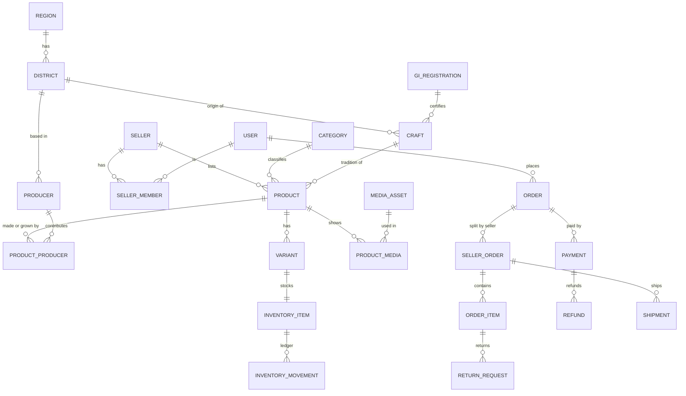

# Database design (PostgreSQL)

> **Status: Proposed — not approved.** No database exists. Introduced only through an approved backend milestone (CLAUDE.md §7). See [TARGET_ARCHITECTURE](TARGET_ARCHITECTURE.md).

## Entity relationships

## Tables

### Geography and culture

| Table | Key columns |
|---|---|
| `regions` | `id`, `iso_code` (e.g. `IN-BR`, `IN-LA`, `IN-DH`) unique, `kind` (`state`, `ut`), `slug`, `name`, `name_native`, `status` (`hidden`, `preview`, `live`), `sort_order` |
| `districts` | `id`, `region_id`, `lgd_code` unique, `slug`, `name`, `geo_key`, `status` |
| `gi_registrations` | `id`, `application_no`, `name`, `registered_on`, `source_url`, `verified_by`, `verified_at` |
| `crafts` | `id`, `slug`, `name`, `name_native`, `region_id`, `origin_district_id`, `gi_registration_id` nullable, `hook`, `story`, `technique`, `status` |
| `categories` | `id`, `parent_id`, `slug`, `name`, `sort_order` (tree) |

### People and sellers

| Table | Key columns |
|---|---|
| `producers` | `id`, `kind` (`artisan`, `farmer`, `collective`, `fpo`), `slug`, `display_name`, `district_id`, `bio`, `verification_status`, `verified_by`, `verified_at`, `consent_published_at` |
| `sellers` | `id`, `legal_name`, `display_name`, `gstin`, `kyc_status`, `payout_ref` (provider token, not bank details), `registered_address` jsonb, `status` |
| `seller_members` | `seller_id`, `user_id`, `role` (`owner`, `staff`) |
| `users` | `id`, `email`, `phone`, `name`, `created_at` |
| `user_roles` | `user_id`, `role` (`admin`, `moderator`, `curator`), `region_id` nullable for scoped curators |
| `sessions` | `id`, `user_id`, `token_hash`, `expires_at`, `created_ip`, `mfa_verified` |
| `addresses` | `id`, `user_id`, address fields, `pincode`, `is_default` |

### Catalogue

| Table | Key columns |
|---|---|
| `products` | `id`, `seller_id`, `slug` unique, `title`, `description`, `category_id`, `craft_id`, `origin_district_id`, `status` (`draft`, `in_review`, `published`, `archived`), `stock_mode` (`one_of_one`, `made_to_order`, `stocked`), `hsn_code`, `gst_rate`, `country_of_origin`, `search` tsvector |
| `product_producers` | `product_id`, `producer_id`, `role` (`maker`, `farmer`, `designer`) |
| `product_claims` | `product_id`, `kind` (`gi`, `origin`, `handmade`, `organic`, …), `value`, `evidence_url`, `verified_by`, `verified_at` |
| `variants` | `id`, `product_id`, `sku` unique, `price_paise`, `mrp_paise`, `attributes` jsonb, `weight_g`, `dimensions_mm`, `best_before` nullable |
| `inventory_items` | `variant_id` PK, `on_hand`, `reserved`, `version` (optimistic lock) |
| `inventory_movements` | `id`, `variant_id`, `delta`, `reason` (`receive`, `reserve`, `release`, `sale`, `return`, `adjust`), `ref_type`, `ref_id`, `actor_id`, `at` |

### Media

| Table | Key columns |
|---|---|
| `media_assets` | `id`, `owner_type`, `owner_id`, `type` (`image`, `video`, `model_3d`, `poster`, `texture`), `storage_key`, `format`, `bytes`, `width`, `height`, `poly_count`, `version`, `approval_status`, `alt`, `credit`, `checksum`, `derivatives` jsonb |
| `product_media` | `product_id`, `asset_id`, `position`, `is_primary` |

### Commerce

| Table | Key columns |
|---|---|
| `carts`, `cart_items` | `user_id` or anonymous token; `variant_id`, `qty` |
| `orders` | `id`, `number`, `user_id`, `status`, `subtotal_paise`, `shipping_paise`, `tax_paise`, `total_paise`, `currency` (`INR`), `shipping_address` jsonb snapshot, `idempotency_key` |
| `seller_orders` | `id`, `order_id`, `seller_id`, `status` (`pending`, `accepted`, `packed`, `shipped`, `delivered`, `cancelled`) |
| `order_items` | `id`, `seller_order_id`, `variant_id`, snapshot of title, price, GST rate and HSN, `qty` |
| `payments` | `id`, `order_id`, `provider`, `provider_ref`, `status`, `amount_paise`, `raw_event` jsonb |
| `refunds` | `id`, `payment_id`, `amount_paise`, `reason`, `status`, `provider_ref` |
| `shipments` | `id`, `seller_order_id`, `carrier`, `awb`, `status`, `events` jsonb |
| `return_requests` | `id`, `order_item_id`, `reason`, `status`, `resolution` |

### Operations

| Table | Key columns |
|---|---|
| `audit_log` | `id`, `actor_id`, `action`, `entity_type`, `entity_id`, `before` jsonb, `after` jsonb, `at` |
| `outbox_events` | `id`, `topic`, `payload` jsonb, `created_at`, `processed_at` |

## Rules

- **Money** is integer paise with `currency = 'INR'`. Never floating point.
- **Orders snapshot** title, price, tax, HSN and address; later catalogue edits never change a past order.
- **Claims are data with evidence.** Editing a claim, the origin district or a producer link returns the product to `in_review`.
- **No hard deletes** on business records; use status and `archived`.
- **Presentation is not stored here.** Palettes, motifs, fonts and shlokas stay in the repository, keyed by `iso_code`.
- **Binary files are never stored in Postgres**; only storage keys and metadata.

## Indexes (initial)

- `products (status, category_id)`, `products (origin_district_id)`, `products (seller_id, status)`
- GIN on `products.search`; `pg_trgm` GIN on `products.title` for fuzzy, transliterated matches (*makhana* / *makhaana*)
- `variants (product_id)`, `inventory_movements (variant_id, at)`, `orders (user_id, created_at)`, `seller_orders (seller_id, status)`
- Unique `payments (provider, provider_ref)` for webhook idempotency

## Migrations

`goose` migrations in the API repository, applied by a separate `cmd/migrate` step before the API rolls out. Every migration must be backward compatible with the previous API version for one release.
