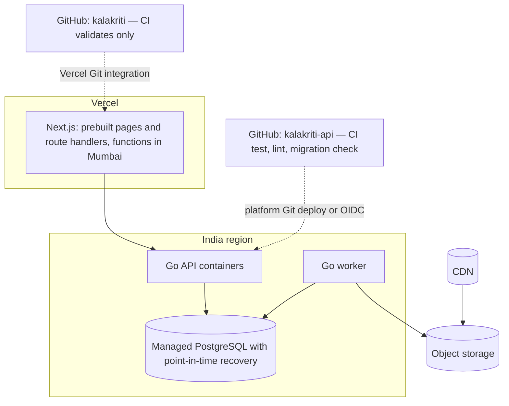

# Deployment architecture

> **Implemented map milestone — 2026-11-17:** The approved state-first 3D map and cultural showcase now exist. See [Three.js architecture](THREEJS_ARCHITECTURE.md) for the implemented boundaries and decision table. Runtime is lazy vanilla Three.js; meshes are generated offline into same-origin gzip buffers, with D3 fallback. Hash-named buffers have immutable cache headers; CSP and the default `.next` deployment output remain unchanged. `KALAKRITI_BUILD_DIR=.next-relief` is an optional isolated local QA output. Backend, product viewers and other target domains below remain proposals.

> **Status: Proposed — not approved,** except where marked *current*. The current deployment path must not change without approval (CLAUDE.md §12, §13).

## Current

- Vercel's Git integration deploys the Next.js site from `main`. Build settings are Vercel defaults; Node comes from `engines.node`.
- GitHub Actions only validates (`pnpm validate`), with `permissions: contents: read` and no secrets.
- Security headers and the GeoJSON cache policy come from `next.config.mjs`.
- No environment variable is required to build.

## Target

| Component | Proposal | Status |
|---|---|---|
| Frontend | Vercel, unchanged; functions pinned to the Mumbai region near the API | Current, plus region pin |
| Go API and worker | Containers on a platform with an Indian region | **Decision:** provider |
| PostgreSQL | Managed, Indian region, point-in-time recovery, daily backups tested by restore | **Decision:** provider |
| Object storage and CDN | Public and incoming buckets; CDN on a `media.` subdomain | **Decision:** provider |
| Secrets | Vercel environment variables (frontend); platform secrets (API). Never in either repository or CI | — |

## Environments

| Environment | Frontend | API and database |
|---|---|---|
| Preview | Vercel preview per pull request | Staging |
| Staging | Vercel deployment of a staging branch | Staging API, staging database with synthetic data |
| Production | Vercel production from `main` | Production |

## Release rules

- **No long-lived deploy tokens in CI.** The backend deploys through the platform's Git integration or short-lived OIDC credentials.
- **Migrations run first**, as a separate step, and stay backward compatible with the running API for one release.
- **Revalidation:** the worker calls `POST /api/revalidate` on Vercel after published data changes.
- **Webhooks** from payment and courier providers go to the API, never to Vercel.
- Every new origin needs a CSP update, cache policy and failure fallback before release.

## Frontend environment variables (when Phase B starts)

| Variable | Scope | Notes |
|---|---|---|
| `API_BASE_URL` | Server only | Never `NEXT_PUBLIC_` |
| `REVALIDATE_SECRET` | Server only | Shared with the worker |
| `NEXT_PUBLIC_SITE_URL` | Public | Required once `lib/env.ts` is imported, or the build fails |

## Observability (Phase B)

Structured logs (`slog`) with request ids carried from the Next server to Go; error tracking on both sides; uptime checks on the public API; alerts on webhook failures and on the outbox backlog.
