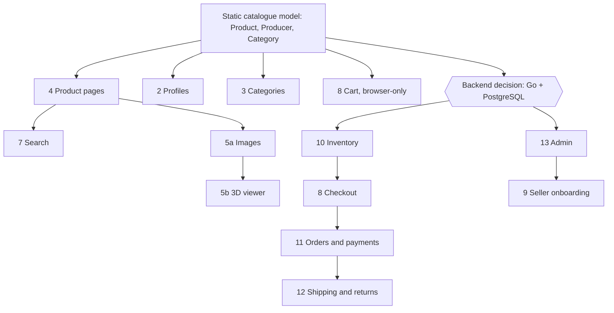

# Product gap analysis

> **Status: Partially implemented — discovery homepage approved by the user on 2026-11-17; the 3D map/showcase is now implemented; commerce, product viewers and immersive scenes remain proposed.** Compares the code at commit `6473826` (2026-11-17) with the Kalakriti vision: a trusted Indian marketplace connecting customers with authentic artisans, farmers and regional producers, starting with Mithila/Bihar and designed to expand to every state and union territory.

## Implemented discovery milestone

The user supplied a heritage storefront visual reference. Implemented: server-rendered illustrated homepage, region/craft navigation, header craft/region search, opt-in existing D3 map, keyboard map selection, load retry, shared footer and transparent catalogue preview controls. Generated illustrations are labeled and do not represent verified inventory or named makers. Real photography, producer records, product pages, subscriptions, shopping, backend and 3D remain future work.

## Summary

Kalakriti today is a strong storytelling and discovery front end with **no commerce layer**. Storytelling is close to complete for Bihar, discovery and categories are partial, and the other areas do not exist. Eight of the missing areas need a backend, so the backend decision is the main gate.

Priority: P0 (first) to P3. Complexity: S / M / L.

| # | Area | Status | Business importance | Priority | Complexity |
|---|---|---|---|---|---|
| 1 | State-based product discovery | Partial; needs architectural improvement | Critical | P0 | M |
| 2 | Artisan and farmer profiles | Not implemented | Critical | P0 | M |
| 3 | Categories and regional collections | Partial | High | P0 | S–M |
| 4 | Product detail pages | Not implemented | Critical | P0 | M |
| 5a | Product images | Partial (support built, no photographs) | Critical | P1 | S code, L content |
| 5b | 3D product viewing | Not implemented | Low–medium (enhancement) | P3 | L |
| 6 | State-based storytelling | Implemented for Bihar; partial elsewhere | High | P2 (verify content) | S |
| 7 | Search and filtering | Not implemented | Medium now, high at scale | P1 | S static, M backend |
| 8 | Shopping cart and checkout | Not implemented | Critical for revenue | P1 | M cart, L checkout |
| 9 | Seller onboarding | Not implemented | High at scale, low for the pilot | P2 | L |
| 10 | Inventory management | Not implemented | High once selling | P1 | M |
| 11 | Orders and payments | Not implemented | Critical for revenue | P1 | L |
| 12 | Shipping and returns | Not implemented | High once selling | P1–P2 | M–L |
| 13 | Admin management | Not implemented | High once selling | P2 | L |

## Area detail

### 1. State-based product discovery — partial, needs architectural improvement
- **Exists:** d3 map of 36 regions with panel and "Explore →"; navbar menu in 7 groups; 36 state pages; Bihar's district map links districts to crafts.
- **Gaps:** only Bihar has products (12 placeholders); outdated geometry; nav shows the wrong region on state pages; map not keyboard operable; catalogue is TypeScript, so adding a product is a code deploy.
- **Dependencies:** authoritative map source; a catalogue source abstraction (static first, database later).

### 2. Artisan and farmer profiles — not implemented
- **Exists:** `Craft.makers` is a free-text sentence. No producer entity; products do not name who made them; no verification.
- **Dependencies:** a `Producer` record (kind, district, crafts, verification status, consent to publish); many-to-many product–producer links; consented, verified content. Seller identity display may be a legal requirement for selling in India (*not yet checked*).

### 3. Categories and regional collections — partial
- **Exists:** crafts act as per-state collections; craft names for all 36 states.
- **Gaps:** no cross-state category taxonomy (paintings, textiles, food, …); no collection pages.
- **Dependencies:** a taxonomy decision and a `category` field. Buildable on static data.

### 4. Product detail pages — not implemented
- **Exists:** products are cards inside a craft accordion, addressable only by `#id` anchors. No URL, metadata or structured data.
- **Dependencies:** product slugs, a `/p/[slug]` route, producers (2), images (5a); delivery and returns information later (12).

### 5a. Product images — partial
- **Exists:** `ImageAsset` type and `Frame` (photo or motif fallback). Zero photographs.
- **Dependencies:** photography (the main cost); a gallery; `/public` is enough for a small pilot, object storage and a CDN beyond that.

### 5b. 3D product viewing — not implemented
- **Dependencies:** product pages; the Frame fallback as poster; the lazy-load pattern from `DistrictMapPanel`; Three.js (approval); accurate models of real items.

### 6. State-based storytelling — implemented for Bihar
- **Exists:** chapters, craft stories, experiences, destinations, district map; honest overviews elsewhere; works without JavaScript.
- **Gaps:** unverified claims; experiences have prices and "Book" buttons, an unscoped second commerce flow; no photography.

### 7. Search and filtering — not implemented
- **Dependencies:** product pages and categories. At pilot size, client-side search over a static index; Postgres full-text later.

### 8. Shopping cart and checkout — not implemented
- **Exists:** inert buttons carrying `data-product-id`.
- **Dependencies:** a browser-only cart needs no backend. Checkout needs a server (re-pricing, stock reservation, order record, payment). It ends the "everything static" posture for checkout pages and needs CSP changes for the payment provider.

### 9. Seller onboarding — not implemented
- **Dependencies:** auth, producer and seller model, verification workflows, KYC and payout handling, validated uploads, admin approval. For the pilot, the internal team can onboard sellers through admin.

### 10. Inventory management — not implemented
- **Dependencies:** database; stock modes for one-of-one art, made-to-order and perishables; reservation at checkout.

### 11. Orders and payments — not implemented
- **Exists:** placeholder Razorpay variables in `.env.example`.
- **Dependencies:** backend, payment provider and webhooks, idempotency, refunds, GST invoicing, payout model (business decision).

### 12. Shipping and returns — not implemented
- **Dependencies:** orders; courier integration or manual dispatch; category-specific returns policy; packaging for fragile pieces.

### 13. Admin management — not implemented
- **Dependencies:** role-based auth, audit history, catalogue, producer, order and verification management.

## Critical path

**Phase A (no backend):** extend the typed data into Product, Producer and Category with stable ids; build product pages, profiles, categories, search and a browser cart on static pages. This is the Mithila discovery slice (CLAUDE.md §15, milestone 4).

**Phase B (backend):** inventory, checkout, orders, payments, shipping and admin, designed together on one approved backend milestone.

## Open decisions

| # | Decision | Status |
|---|---|---|
| 1 | Interim selling: disabled "coming soon" buttons, or assisted ordering (enquiry form or payment link) | Open |
| 2 | Category taxonomy for the first release | Open |
| 3 | Start the backend design in parallel with Phase A, or after it | Open |
| 4 | Payment provider and payout model (marketplace split payments vs buy-and-resell) | Open |
| 5 | Who collects consented, verified producer content and photography for Mithila | Open |

## Approved map milestone

The homepage is now map-first with 3D state relief and regional hover, a shared selection store, an opt-in cultural showcase with manual controls, and the original D3 map/train retained in 2D. All region pages remain. This fills geographic presentation/interaction gaps, not real inventory, producer verification, checkout or authoritative geographic data. See [implementation evidence](../audit/THREE_MAP_IMPLEMENTATION.md).
