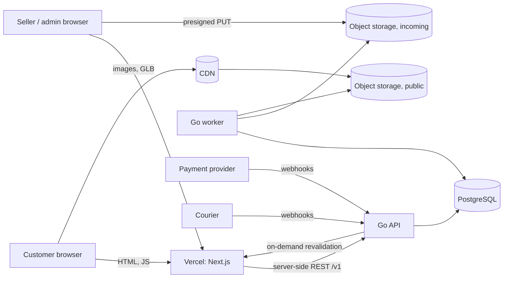
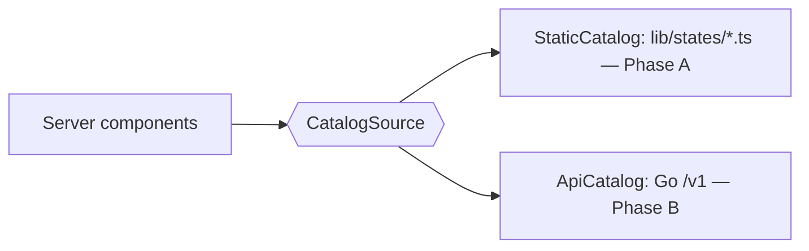
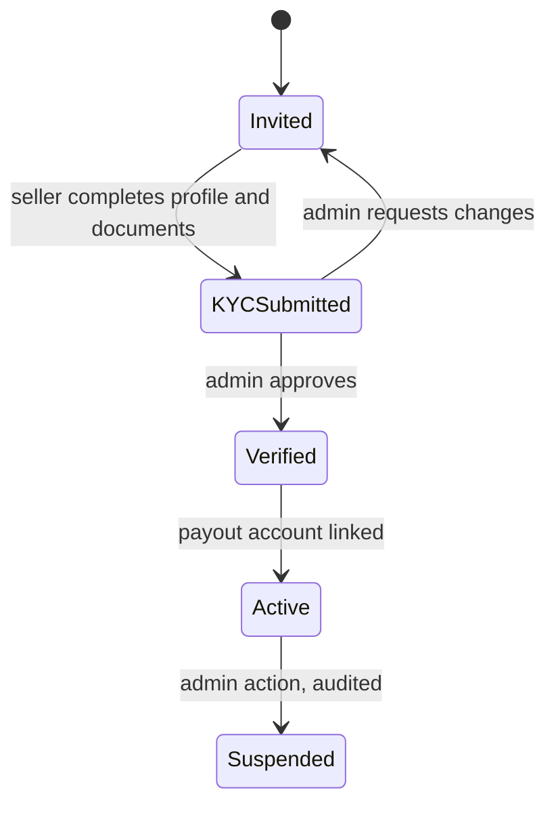
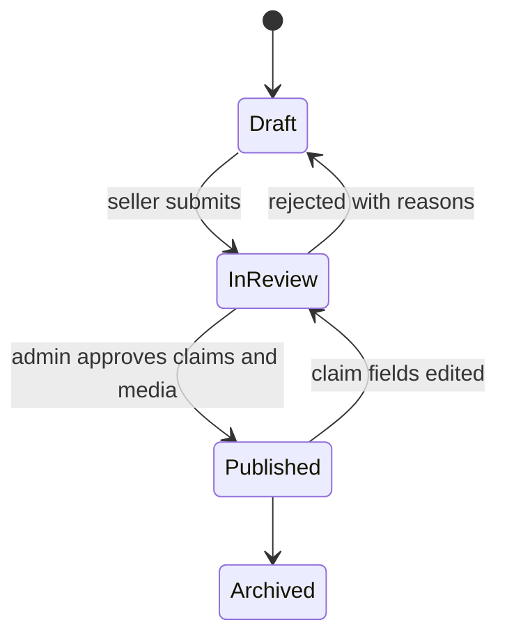

# Target architecture

> **Implemented Bihar collection and reading routes — 2026-11-21:** The approved Bihar flow separates district-labelled craft discovery, nine craft collections and four journal articles. All thirteen new destinations are prebuilt; no client data layer, dependency or commerce service was introduced. [Current behavior and evidence](../audit/BIHAR_MITHILA_JOURNAL.md).

> **Implemented Bihar journal redesign — 2026-11-20:** Bihar now has a dedicated static, server-rendered Mithila journal. The district map is removed from its page at the user’s request; the independent atlas and other region pages retain their existing architecture. Native details provide stories and previews without a new client island. [Design, imagery and evidence](../audit/BIHAR_MITHILA_JOURNAL.md).

> **Implemented regional editorial milestone — 2026-11-20:** All 36 existing region routes incorporate craft introductions from a typed server-side content module. The 35 overview pages render three selected descriptive craft cards, while Bihar retains its detailed content. No new runtime data service, route, dependency or map architecture was introduced. [Implementation and sources](../audit/STATE_CRAFT_CONTENT.md).

> **Latest homepage — 2026-11-19:** The new reference-inspired heritage journal composition is implemented, with three regional stories, eight textile studies and a panoramic embroidery scene. Existing imagery, state routes and the separate atlas are preserved. See [implementation and image provenance](../audit/HERITAGE_JOURNAL.md).

> **Homepage visual update — 2026-11-19:** The homepage now follows the supplied panoramic heritage reference, with a horizontal state strip and image-led Mithila feature. The original courtyard artwork is preserved on Bihar’s page. The interactive map remains at `/explore`. See [heritage refresh](../audit/HERITAGE_REFRESH.md).

> **Current composition — 2026-11-19:** Geographic discovery now lives at the dedicated static `/explore` route, with a borderless full-width map presentation. The illustrated homepage contains no map section. Header, hero, footer and state-page map links lead to this destination. See [dedicated atlas implementation](../audit/EXPLORE_ATLAS.md).

> **Latest approved composition — 2026-11-17:** Following user feedback, the illustrated craft-and-culture hero again opens the homepage. 3D geographic discovery and the opt-in cultural showcase remain immediately below, in one compact framed section. Renderer, store, fallback and offline asset decisions remain implemented; see [homepage refinement](../audit/HOMEPAGE_BALANCE.md).

> **Implemented map milestone — 2026-11-17:** The approved state-first 3D map and cultural showcase now exist. See [Three.js architecture](THREEJS_ARCHITECTURE.md) for the implemented boundaries and decision table. Runtime is lazy vanilla Three.js; meshes are generated offline into same-origin gzip buffers, with D3 fallback. Hash-named buffers have immutable cache headers; CSP and the default `.next` deployment output remain unchanged. `KALAKRITI_BUILD_DIR=.next-relief` is an optional isolated local QA output. Backend, authored product models and other target domains below remain proposals. A bounded Kohbar image-backed detail viewer was implemented on 21 November 2026; see the Three.js architecture.

> **Status: Proposed — not approved.** Nothing here is implemented. Items marked **Decision** need explicit approval (CLAUDE.md §14, Phase 3). Based on the [audit](../audit/REPOSITORY_OVERVIEW.md) and the [gap analysis](GAP_ANALYSIS.md).
>
> Companion documents: [database](DATABASE_DESIGN.md) · [API](API_DESIGN.md) · [Three.js](THREEJS_ARCHITECTURE.md) · [asset pipeline](ASSET_PIPELINE.md) · [deployment](DEPLOYMENT_ARCHITECTURE.md).

## Principles

| Principle | Consequence |
|---|---|
| Keep Next.js 14.2 for now; the Next 15 upgrade is a separate decision | Dynamic pages and route handlers widen exposure to the Next 14 advisories. Decide on Next 15 before Phase B ships |
| Public pages stay prebuilt | Landing, state, category, product and maker pages are built ahead of time and revalidated on demand. Only cart, checkout, account, seller and admin pages render per request |
| Go modular monolith in a separate repository (`kalakriti-api`) | Matches CLAUDE.md §3.1 (no monorepo) and §7. An OpenAPI file is the contract |
| PostgreSQL holds business facts; the repository holds presentation | Palettes, motifs, fonts and shlokas stay in TypeScript. Regions, crafts, producers and products move to Postgres |
| The browser talks only to the Next server | Next route handlers forward to Go. `connect-src` stays same-origin and cookies stay first-party |
| 3D is progressive enhancement | Fallback order: 3D, then the SVG map, then a plain list or gallery |

## System context



## 1. Frontend architecture

### Routes

| Route | Rendering | Notes |
|---|---|---|
| `/` | Static; hero rendered on the server | Map stays client-only |
| `/state/[region]` | Prebuilt, revalidated on demand | Exists today |
| `/state/[region]/[district]` | Prebuilt, revalidated on demand | Only districts with catalogue entries |
| `/c/[category]`, `/collections/[slug]` | Prebuilt, revalidated on demand | |
| `/p/[slug]` | Top products prebuilt, the rest built on first request | Optional 3D viewer island |
| `/makers/[slug]` | Prebuilt, revalidated on demand | Artisan and farmer profiles |
| `/search` | Static shell, client results through the Next server | |
| `/cart` | Static shell, browser cart | |
| `/checkout`, `/account/*` | Per request, authenticated | |
| `/sell/*` | Per request, seller role, `noindex` | |
| `/admin/*` | Per request, admin role, `noindex` | **Decision:** same app (recommended to start) or separate deployment |
| `/api/bff/*`, `/api/revalidate` | Route handlers | The only server code in Next |

### Layout (new folders only; existing files stay)

```text
app/
  (shop)/  page.tsx · state/ · c/ · p/ · makers/ · search/ · cart/ · checkout/ · account/
  (seller)/sell/…      (admin)/admin/…
  api/bff/[...path]/route.ts      api/revalidate/route.ts
  styles/  tokens.css · base.css · nav.css · map.css · state.css · commerce.css …
lib/
  catalog/  types.ts · source.ts · static-source.ts · api-source.ts
  api/      server-only client for the Go API; types generated from OpenAPI
  regions/  registry.ts (ISO-keyed presentation) · geometry.ts
  three/    renderer lifecycle, capability detection, loaders
  store/    useRegionStore.ts · useCartStore.ts
components/
  ornament/ · state/ · layout/   (existing)
  map/       RegionMap · SvgIndiaMap · MapThreeView · RegionPanel · CanvasField
  commerce/  ProductCard · PriceTag · AddToCartButton · CartLine · GiBadge
  producer/  ProducerCard · ProducerProfile · VerificationMark
  product/   Gallery · ProductViewer3D · ProvenanceBlock
```

### Catalogue source



Pages never import data files directly. Switching from static data to the API is a one-file change, and the static source remains a test fixture.

### Client state

- `useRegionStore` stays the single selection source for every map view. A shared `useRegionTheme` hook applies the theme on landing and state pages (fixes [TECHNICAL_DEBT E1](../audit/TECHNICAL_DEBT.md)).
- `useCartStore` persists variant ids and quantities only. The server re-prices at checkout.

### CSS

Keep the `kk-*` global-class convention. Split `globals.css` into ordered partials imported from the root layout. **Decision:** disable Tailwind's reset now and remove Tailwind later. No CSS Modules, to keep one convention.

## 2. Reusable component architecture

| Layer | Contents | Rules |
|---|---|---|
| Tokens | `--kk-*` slots, font registers, breakpoints | No literal colours; register all eight slots with `@property` |
| Ornament | `Motif`, `BorderPatti` | Unchanged |
| Primitives | `Frame`, `SectionHead`, `.kk-btn`, chips, `RevealRoot` | Server components by default |
| Domain | commerce, producer, product, region | Server components with small client islands |
| Experiences | `RegionMap`, `DistrictMap`, `ProductViewer3D` | Client-only, lazy-loaded, explicit fallback |

What to reuse, refactor or leave alone is listed in [REUSABLE_COMPONENTS](../audit/REUSABLE_COMPONENTS.md). The main refactors: split `IndiaMap.tsx`; make `TopNav` derive its region from the URL; give `ProductRail` a real `AddToCartButton`; add `srcset` to `Frame`; move product and producer types to `lib/catalog/`; re-key `stateThemes.ts` by ISO 3166-2:IN code.

## 3. Three.js experiences and d3 coexistence

See [THREEJS_ARCHITECTURE](THREEJS_ARCHITECTURE.md). In short: both map renderers read and write the same store and share the same region registry, panel, hero and nav. d3-geo supplies the projection for both. The SVG map stays the accessible default; the 3D view is opt-in until a spike shows it is worth more.

## 4. State and region data architecture

| Data | Lives in | Key |
|---|---|---|
| Region identity: palette, motif, font, script line, shloka | Repository, `lib/regions/registry.ts` | ISO 3166-2:IN code |
| Regions, districts, status (`hidden`, `preview`, `live`) | Postgres `regions`, `districts` | ISO code; official LGD codes for districts |
| Crafts, GI registrations, stories | Postgres | id and slug |
| Producers, products, media | Postgres and object storage | id and slug |
| Geometry (India; districts per state) | Built files, versioned names, immutable cache | ISO or LGD code in feature properties |

The geometry pipeline is described in [ASSET_PIPELINE](ASSET_PIPELINE.md).

## 5. Backend Go project structure

```text
kalakriti-api/
  cmd/api/  cmd/worker/  cmd/migrate/
  api/openapi.yaml
  internal/platform/     config, pgx pool, net/http routing, slog, auth middleware,
                         problem+json errors, outbox, metrics
  internal/modules/
    identity/ region/ catalog/ producer/ media/ inventory/
    cart/ order/ payment/ shipping/ seller/ admin/
      each: http.go · service.go · repo.go (sqlc) · model.go · events.go
  migrations/            goose
```

- Proposed libraries: standard-library `net/http` routing, `pgx` v5, `sqlc`, `goose`, `slog`.
- Modules call each other through service interfaces, never through another module's tables.
- Side effects go through a transactional outbox processed by the worker (payment captured → stock committed, notifications sent; product published → frontend revalidated).

## 6–7. Database and API

See [DATABASE_DESIGN](DATABASE_DESIGN.md) and [API_DESIGN](API_DESIGN.md).

## 8. Authentication and authorisation

- **Customers:** phone or email OTP, then an opaque random session token stored hashed in Postgres. The Next server sets it as an `HttpOnly; Secure; SameSite=Lax` cookie on the main domain and forwards it to Go.
- **Sellers:** same login plus `seller_members` (owner, staff). Every seller endpoint checks that the resource belongs to the caller's seller.
- **Admins:** a second factor is mandatory (passkey or TOTP); short sessions; roles `admin`, `moderator`, and `curator` scoped to regions.
- **Go enforces every rule.** Guards in Next layouts are for user experience only, which also avoids relying on Next 14 middleware.
- **CSRF:** `SameSite=Lax` plus an `Origin` check on mutating calls through the Next server.
- Rate limits on OTP and login. Only partial KYC identifiers stored. Payout bank details held by the payment provider as tokens.
- Next-side secrets: `API_BASE_URL`, `REVALIDATE_SECRET` — server-only, never `NEXT_PUBLIC_`.

## 9. Seller and admin workflows





- **Order fulfilment:** paid → seller accepts → packed → shipped → delivered → return window → settled. Each seller's part of a multi-seller order moves independently.
- **Producer verification** is separate from seller verification: a collective may sell work by many artisans.
- **Mithila pilot:** onboarding is assisted by the internal team through admin. Self-service reuses the same states later.

## 10–11. Assets and deployment

See [ASSET_PIPELINE](ASSET_PIPELINE.md) and [DEPLOYMENT_ARCHITECTURE](DEPLOYMENT_ARCHITECTURE.md).

## Scaling to all states and union territories

1. Adding a region is data, not code: a region row, a registry entry, geometry and content.
2. Region status controls what navigation and the map show.
3. Districts load lazily per state using LGD codes; only districts with catalogue entries get pages.
4. Build time stays bounded: prebuild regions, categories and top products; build the rest on demand.
5. Postgres full-text search first; a dedicated search engine only when measured load justifies it.
6. Translation tables later; the Indic font stacks already exist.
7. Region-scoped curator roles and verification queues.

## Decisions

| # | Decision | Recommendation | Status |
|---|---|---|---|
| 1 | Next 15 upgrade timing | Before Phase B | Open |
| 2 | Tailwind | Disable reset now, remove later | Open |
| 3 | Authoritative map boundary source | — | Open |
| 4 | Vanilla Three.js vs React Three Fiber | Vanilla until the spike | Open |
| 5 | CSP additions for 3D | Required for compressed models | Open |
| 6 | Object storage, CDN, Go host, Postgres provider | Hosted in India | Open |
| 7 | Admin inside the main app or separate | Inside, to start | Open |
| 8 | Customer login method; payment provider and payout model | — | Open |

**Implemented regional expansion — 21 November 2026:** Jammu & Kashmir now has a typed regional chapter, collection/journal/detail routes and region-aware shared catalogue/cart. This extends the existing static frontend and mock market pricing without approving or introducing a backend. The Bihar flow and original detail URLs are retained. See [regional implementation](../audit/JAMMU_KASHMIR_JOURNAL.md).

**Implemented regional expansion — 21 November 2026:** West Bengal now follows the static regional collection/journal/product pattern. Shared route-facing theme metadata and the sample catalogue region list support Bihar, Jammu & Kashmir and West Bengal. This introduces no backend, live inventory, authored model assets or payment integration.

**Implemented regional expansion — 21 November 2026:** Odisha extends the existing static regional pattern and sample catalogue to a fourth region, using the established viewer, basket and theme metadata. The data remains local frontend fixtures; no backend, payments, booking service or authored product model assets are introduced.

**Implemented regional expansion — 21 November 2026:** Jharkhand extends the shared static chapter, catalogue, currency selector and cart to a fifth region. Six collections, six item routes and three reading routes use local fixtures; no backend, payment service or new renderer is introduced.

**Implemented regional expansion — 21 November 2026:** Uttar Pradesh extends the static regional chapter and shared sample catalogue/cart to a sixth region. Six collections, six product routes and three reading routes reuse the established frontend architecture. No backend, payment system, dependency or renderer change is introduced.

**Implemented regional expansion — 21 November 2026:** Uttarakhand extends the static chapter and shared sample catalogue/cart to a seventh region. Six collections, six item routes and three reading routes reuse the existing frontend architecture. No backend, dependency, payment or renderer change is introduced.

**Implemented regional expansion — 21 November 2026:** Himachal Pradesh extends the static chapter and shared sample catalogue/cart to an eighth region. Six collections, six item routes and three reading routes reuse the existing frontend architecture. No backend, payment, dependency or renderer change is introduced.

**Implemented regional expansion — 21 November 2026:** Madhya Pradesh extends the static chapter and shared sample catalogue/cart to a ninth region. Six collections, six item routes and three reading routes reuse the existing frontend architecture. No backend, payment, dependency or renderer change is introduced.


**Implemented regional expansion — 21 November 2026:** Chhattisgarh extends the static chapter and shared sample catalogue/cart to a tenth region. Six collections, six item routes and three reading routes reuse the established frontend architecture. No backend, payment, dependency or renderer change is introduced.


**Implemented regional expansion — 21 November 2026:** Punjab extends the static chapter and shared sample catalogue/cart to an eleventh region. Six collections, six item routes and three reading routes reuse the established frontend architecture. No backend, payment, dependency or renderer change is introduced.


**Implemented regional expansion — 21 November 2026:** Haryana extends the static chapter and shared sample catalogue/cart to a twelfth region. Six collections, six item routes and three reading routes reuse the established frontend architecture. No backend, payment, dependency or renderer change is introduced.


**Implemented regional expansion — 21 November 2026:** Delhi extends the static chapter and shared sample catalogue/cart to a thirteenth region. Six collections, six item routes and three reading routes reuse the existing frontend architecture. No backend, payment, dependency or renderer change is introduced.


**Implemented regional expansion — 22 November 2026:** Kerala extends the static chapter and shared sample catalogue/cart to a fifteenth region, including the existing Chandigarh chapter. Six collections, six item routes and three reading routes reuse the established frontend architecture. No backend, payment, dependency or renderer change is introduced.


**Implemented regional expansion — 22 November 2026:** Karnataka extends the static chapter and shared sample catalogue/cart to a sixteenth region. Six collections, six item routes and three reading routes reuse the established frontend architecture. No backend, payment, dependency or renderer change is introduced.


**Implemented regional expansion — 22 November 2026:** Tamil Nadu extends the static chapter and shared sample catalogue/cart to a seventeenth region. Six collections, six item routes and three reading routes reuse the established frontend architecture. No backend, payment, dependency or renderer change is introduced.

**Implemented regional expansion — 22 November 2026:** Andhra Pradesh extends the static chapter and shared sample catalogue/cart to an eighteenth region. Six collections, six item routes and three reading routes reuse the established frontend architecture. No backend, payment, dependency or renderer change is introduced.

**Implemented regional expansion — 22 November 2026:** Telangana extends the static chapter and shared sample catalogue/cart to a nineteenth region. Six collections, six item routes and three reading routes reuse the established frontend architecture. No backend, payment, dependency or renderer change is introduced.

**Implemented regional expansion — 22 November 2026:** Puducherry extends the static chapter and shared sample catalogue/cart to a twentieth region. Six collections, six item routes and three reading routes reuse the established frontend architecture. Visitor information includes Puducherry, Karaikal, Mahé and Yanam without inventing catalogue origins in each enclave. No backend, payment, dependency or renderer change is introduced.

**Implemented regional expansion — 22 November 2026:** Andaman & Nicobar and Lakshadweep extend the static chapter and shared sample catalogue/cart to twenty-two regions. Six Andaman and three Lakshadweep collections connect twelve item routes and six reading routes. Broad regional craft associations avoid invented island or community product provenance; visitor links include official access-information pathways. No backend, payment, dependency or renderer change is introduced.

**Implemented regional expansion — 22 November 2026:** Rajasthan extends the static chapter and shared sample catalogue/cart to a twenty-third region. Six collections, six item routes and three reading routes reuse the established frontend architecture. No backend, payment, dependency or renderer change is introduced.

**Implemented regional expansion — 22 November 2026:** Gujarat extends the static chapter and shared sample catalogue/cart to a twenty-fourth region. Six collections, six item routes and three reading routes reuse the established frontend architecture. No backend, payment, dependency or renderer change is introduced.

**Implemented regional expansion — 22 November 2026:** Maharashtra extends the static chapter and shared sample catalogue/cart to a twenty-fifth region. Six collections, six item routes and three reading routes reuse the existing frontend. No backend, payment, dependency or renderer change is introduced.

**Implemented regional expansion — 22 November 2026:** Goa and the two existing Dadra & Nagar Haveli / Daman & Diu discovery chapters extend the catalogue to 28 regional entries. They share 12 item routes and eight reading routes within the existing static architecture. Cultural discovery entries are not administrative-entity counts; no map/schema migration, backend or dependency change is introduced.

**Implemented regional expansion — 22 November 2026:** Assam begins the Northeast rollout, extending the existing static chapter and shared sample catalogue to 29 discovery entries. Six collections, six item routes and three reading routes reuse the frontend architecture. No backend, dependency or renderer change is introduced.

**Implemented regional expansion — 23 November 2026:** Meghalaya extends the static chapter and shared sample catalogue to 30 discovery entries. Five collections, six item routes and three reading routes reuse the existing architecture. Two Ryndia item forms share one collection rather than being presented as separate traditions. No backend, dependency or renderer change is introduced.

**Implemented regional expansion — 23 November 2026:** Arunachal Pradesh extends the static chapter and shared sample catalogue to 31 discovery entries. Six collections, six item routes and three reading routes reuse the established frontend. No backend, dependency, boundary migration or renderer change is introduced.

**Implemented regional expansion — 23 November 2026:** Nagaland extends the static chapter and shared sample catalogue to 32 discovery entries. Six collections, six item routes and three reading routes reuse the established frontend. No backend, dependency, boundary or renderer change is introduced.


### Manipur chapter — 2026-11-23

Implemented: Manipur follows the approved regional chapter pattern with five material collections, six product viewers, three articles and six visitor entries. This milestone adds no backend, dependency or renderer change. See [implementation](../audit/MANIPUR_JOURNAL.md).


### Mizoram chapter — 2026-11-23

Implemented: Mizoram follows the regional chapter pattern with five collections, six item pages, three articles and six visitor entries. No backend or renderer change is introduced. See [implementation](../audit/MIZORAM_JOURNAL.md).


### Tripura and Sikkim — 2026-11-23

Implemented: Tripura and Sikkim complete the regional chapter rollout across the 36 registered regions. Each uses five collections, six item close-ups, three articles and six visitor entries. This milestone adds no backend, dependency or renderer change. [Tripura](../audit/TRIPURA_JOURNAL.md) and [Sikkim](../audit/SIKKIM_JOURNAL.md) record implementation and sources.


### Account visual design — 2026-11-23

Implemented: login and signup share a full-viewport regional-image carousel, a static Mithila form panel and compact account footer. Existing validation and preview-only submissions remain unchanged. Autoplay is opt-out, manual scene selection is available and reduced-motion preferences stop automatic changes. No account backend, session, email or SMS service is implemented. See [account design](../audit/ACCOUNT_PAGES.md).
