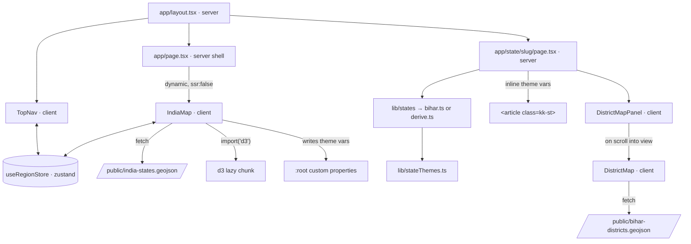

# Existing architecture

> **Bihar collection-first navigation — 2026-11-21:** Bihar now links to nine statically generated craft collections and four journal articles. Craft cards and journal rows navigate instead of expanding. The district-led discovery page no longer renders product previews or availability notices. [Current Bihar implementation](BIHAR_MITHILA_JOURNAL.md).

> **Bihar redesign — 2026-11-20:** Bihar now renders a dedicated server-side Mithila journal with a continuous painted backdrop, illustrated craft cards and native disclosure stories. Its district map is removed from the page; the separate atlas and other state templates remain unchanged. [Implementation and validation](BIHAR_MITHILA_JOURNAL.md).

> **Regional content expansion — 2026-11-20:** All 36 existing region pages now incorporate server-side editorial notes. The 35 overview pages show three selected craft descriptions with material labels in themed parchment cards, while Bihar keeps its detailed catalogue and gains an expanded crafts introduction. See [content scope, source review and validation](STATE_CRAFT_CONTENT.md). Routes, map data and static rendering are preserved.

> **Homepage composition refinement — 2026-11-17:** The user clarified that the illustrated craft-and-culture homepage was preferred. That server-rendered image-led hero is restored. The existing 3D/D3 map and cultural showcase now form a compact regional-discovery section immediately below it, with a single shared frame, a top control bar and a smaller regional preview. No dependencies, scene/geometry logic, configuration or routes changed. Current visual/regression evidence: [HOMEPAGE_BALANCE](HOMEPAGE_BALANCE.md).

> **3D map milestone — 2026-11-17:** RegionalDiscovery is now the map facade: shared selection/hash state, ephemeral hover preview, regional theme, mode controls and one useCulturalShowcase timer. MapThreeView lazily loads createIndiaScene and prepared mesh buffers. RegionPreview is shared by both renderers. IndiaMap managed mode delegates the tour clock and URL handling to the facade while retaining its D3 camera and animated train. Offline generation runs before production builds.

> **Implementation update — 2026-11-17:** app/page.tsx now composes the discovery homepage on the server. RegionalDiscovery.tsx is the small client island that loads IndiaMap with embedded=true on request (or for a recognized region hash). CraftSearch.tsx searches the existing cultural registry. SiteFooter.tsx is shared from RootLayout. IndiaMap retains its D3 initialization/ref bridge, applies regional theme variables locally when embedded, aborts geometry requests, interrupts transitions on cleanup, and provides keyboard path selection and retry UI.

The original baseline audit follows for historical context.

> Audit of commit `6473826`, 2026-11-17.

## Component and data flow

## Server and client components

| Client (`'use client'`) | Server |
|---|---|
| `IndiaMap`, `TopNav`, `DistrictMap`, `DistrictMapPanel`, `RevealRoot` (plus unused scaffolding) | `layout.tsx`, `page.tsx` (shell), the state page and every other `components/state/*` |

The state page stays almost entirely server-rendered. `CraftStory` uses a native `
` accordion so no catalogue data reaches a client bundle.

## Data sources

| Source | Read by | When |
|---|---|---|
| `lib/stateThemes.ts` (36 entries: palette, motif, font, script line, shloka, crafts, description) | Map, nav, state pages, slugs | Compile time |
| `lib/states/bihar.ts` (districts, chapters, crafts, products, experiences, destinations) | Bihar page | Compile time |
| `lib/states/derive.ts` | The other 35 state pages | Compile time |
| `public/*.geojson` | IndiaMap, DistrictMap | Runtime fetch, same origin |

There are **no API integrations**. `ky` is installed and never imported. The only runtime requests are for the two GeoJSON files.

## Selection and theming

- `useRegionStore` holds `selected`, `tour` and `tourIndex`. `select()` validates against `STATE_THEMES` and stops the tour. The map follows the store; the map does not own selection.
- Map clicks, deep links and the tour write to the store. **The navbar no longer does:** every state now has a slug, so every menu row is a `<Link>` to `/state/<slug>` and the store-writing button branch in `TopNav.tsx` never renders. Only the logo and "All of India" call `select(null)`.
- **Two theming paths.** The landing map writes the theme slots onto `:root` at runtime. State pages set them inline on `<article>`. The site bar reads `:root`, which causes the mismatch in [TECHNICAL_DEBT E1](TECHNICAL_DEBT.md).

## The d3 map (`components/landing/IndiaMap.tsx`)

- d3 is imported dynamically inside one effect. Handlers bind once and read React state through refs (`selectedRef`, `selectRef`, `touringRef`, `paletteRef`).
- Mercator projection fitted with `fitExtent`, refitted on `resize` and `orientationchange` (debounced 150 ms).
- `d3-zoom` drives the camera. Line widths, pattern tiles, filter radii, labels and the train are counter-scaled by `1/k`.
- Selected state: woven SVG pattern fill plus a glow filter, recoloured from the open region's palette.
- Island ripples for the Andamans and Lakshadweep use `vector-effect: non-scaling-stroke`.
- The showcase tour runs a train along a curved route between states with named transitions (`fade`, `move`) so they do not cancel each other.
- A separate full-screen `<canvas>` paints mandalas, kolam dots and sea lines on every animation frame.
- The URL hash is kept in step with the selection through `history.replaceState`. Next 14.2 patches `replaceState` and preserves its internal state, so this does not break back navigation.

The district map (`components/state/DistrictMap.tsx`) uses the same lifecycle discipline with stricter types (no `any`), keyboard access, a `ResizeObserver`, and a plain transform camera instead of `d3-zoom`.

## Styling

Hand-written CSS in `app/globals.css` with `kk-*` classes. Eight theme slots; six are registered with `@property` so they cross-fade. Four display font registers (`classic`, `royal`, `temple`, `folk`) plus Devanagari and wider Indic stacks, all self-hosted through `next/font`. Mobile-first with breakpoints at 641, 781 and 901 px, `hover: hover` gating, `pointer: coarse` targets, safe-area insets, and a global reduced-motion block.

Tailwind is installed and its directives sit at the end of `globals.css`. No component uses a utility class, but the Tailwind reset still applies (see [TECHNICAL_DEBT E5](TECHNICAL_DEBT.md)).

## Build and deployment

- Vercel's Git integration deploys. GitHub Actions only validates (`permissions: contents: read`, pnpm 11, Node 24).
- Security headers and the GeoJSON cache policy are set in `next.config.mjs`.
- No environment variable is needed to build; `lib/env.ts` has no importers.

**21 November 2026 — Kohbar detail:** A static `/state/bihar/paintings/[painting]` route now generates one eligible painting detail. Its client gallery lazy-imports an image-backed Three.js surface only on explicit activation; metadata, product information, market prices and cart remain independent of WebGL. This does not add authored GLB assets or a backend.

**21 November 2026 — all Bihar collections:** The product detail/gallery pattern now applies to all 12 catalogue items across nine craft sections. A shared server detail layout and opt-in image-backed 3D viewer provide per-item content, original aspect ratio, close-up labels, market prices, cart and related-product links. Eleven new static `/state/bihar/products/[product]` routes join the preserved Kohbar URL. See `lib/commerce/productDetails.ts`, `components/product/ProductDetail.tsx`, `components/product/ProductGallery.tsx` and `lib/three/createProductScene.ts`. Existing image assets are retained; these are presentation surfaces, not newly authored 3D models.

**21 November 2026 — Jammu & Kashmir:** A second detailed regional data file and server journal now provide six craft collections, six shared item-detail viewers, three reading pages and six tourism entries. The catalogue includes region metadata and the cart can contain both Bihar and Jammu & Kashmir items. Header/footer adapt to the new regional routes; the footer now uses a client boundary for pathname-aware content. All 83 outputs remain static. See [regional implementation](JAMMU_KASHMIR_JOURNAL.md).

**21 November 2026 — West Bengal:** A third typed regional chapter now adds six craft collections, six shared item-detail viewers, three articles and six tourism entries, with a full-page Bengal artwork surround. Lightweight `journalTheme.ts` metadata supplies navbar/footer/cart styling, while `commerce/regions.ts` supplies the three catalogue regions. The build produces 98 static outputs. See [West Bengal implementation](WEST_BENGAL_JOURNAL.md).

**21 November 2026 — Odisha:** A fourth detailed regional chapter adds six craft collections, six shared item-detail viewers, three articles and six tourism links. Its Odia native line, registered temple typography/palette and full-page painted surround follow the same regional metadata pathway. No slogan ribbon is rendered. The build has 113 static outputs. See [Odisha implementation](ODISHA_JOURNAL.md).

**21 November 2026 — Jharkhand:** A fifth detailed regional chapter adds six collections, six item viewers, three articles and six tourism links. The registered earth palette, folk typography, regional navigation/footer and full-page Sohrai-inspired surround are scoped to Jharkhand. The build now has 128 static outputs. See [implementation and sources](JHARKHAND_JOURNAL.md).

**21 November 2026 — Uttar Pradesh:** The sixth detailed chapter adds six collections, six item viewers, three reading routes and six tourism entries. An embroidered ivory ground and the registered burgundy/gold/indigo palette are scoped to `.kk-up-journal`, with regional navigation/footer. The build produces 143 static outputs. See [implementation and sources](UTTAR_PRADESH_JOURNAL.md).

**21 November 2026 — Uttarakhand:** A seventh detailed regional chapter adds six collections, six item viewers, three reading routes and six tourism entries. Aipan-inspired full-page borders and the registered red/brown/green palette are scoped to `.kk-uk-journal`, with regional navigation/footer. The build produces 158 static outputs. See [implementation and sources](UTTARAKHAND_JOURNAL.md).

**21 November 2026 — Himachal Pradesh:** An eighth detailed regional chapter adds six collections, six item viewers, three reading routes and six tourism entries. An embroidered floral ground and the registered red/blue/green palette are scoped to `.kk-hp-journal`, with regional navigation/footer. The build produces 173 static outputs. See [implementation and sources](HIMACHAL_PRADESH_JOURNAL.md).

**21 November 2026 — Madhya Pradesh:** A ninth detailed regional chapter adds six collections, six item viewers, three reading routes and six tourism entries. A Gond-inspired full-page surround and folk typography are scoped to `.kk-mp-journal`, with regional navigation/footer. Its registered terracotta accent is deepened for small-text/button contrast; teal/ochre identity is retained. The build produces 188 static outputs. See [implementation and sources](MADHYA_PRADESH_JOURNAL.md).

**21 November 2026 — Chhattisgarh:** A tenth detailed regional chapter adds six collections, six item viewers, three reading routes and six visitor entries. Bronze coiled lines, forest-green foliage and warm paper are scoped to `.kk-cg-journal`, including regional navigation/footer. The build produces 203 static outputs. See [implementation and sources](CHHATTISGARH_JOURNAL.md).

**21 November 2026 — Punjab:** An eleventh detailed regional chapter adds six collections, six item viewers, three reading routes and six visitor entries. A Phulkari-inspired stitched surround and madder accent are scoped to `.kk-pb-journal`, including regional navigation/footer. The build produces 218 static outputs. See [implementation and sources](PUNJAB_JOURNAL.md).

**21 November 2026 — Haryana:** A twelfth detailed regional chapter adds six collections, six item viewers, three reading routes and six visitor entries. Woven geometry and reed bindings frame the page under `.kk-hr-journal`, with regional navigation/footer and a deepened terracotta accent. The build produces 233 static outputs. See [implementation and sources](HARYANA_JOURNAL.md).

**21 November 2026 — Delhi:** A thirteenth detailed regional chapter adds six collections, six item viewers, three reading routes and six visitor entries. Floral threadwork and carved-screen details frame `.kk-dl-journal`, including regional navigation/footer. The formal registry key remains `NCT of Delhi`, while the route and page title use Delhi. The build produces 248 static outputs. See [implementation and sources](DELHI_JOURNAL.md).
